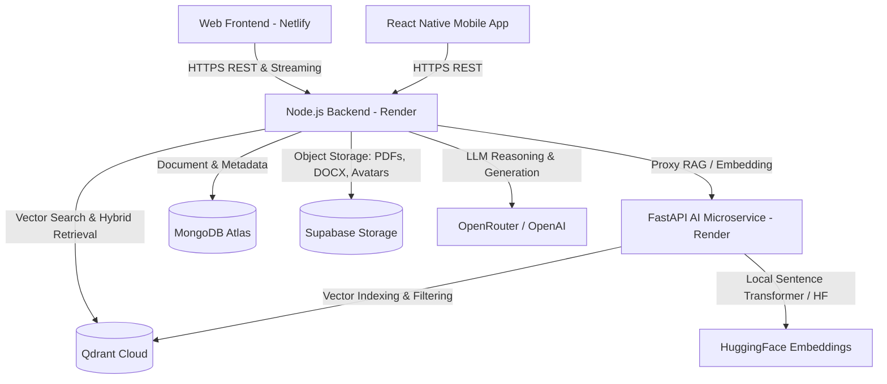

# DOCUMIND-AI Production Deployment Guide

This guide details the exact step-by-step procedure to deploy the DOCUMIND-AI platform across cloud infrastructure (Render, Netlify, MongoDB Atlas, Qdrant Cloud, and Supabase Storage).

---

## Architecture Overview



---

## Deployment Order

To ensure clean zero-downtime startup and dependency resolution, deploy the services in the following order:

1. **MongoDB Atlas** (Database)
2. **Qdrant Cloud** (Vector Database)
3. **Supabase Storage** (Document & Artifact Object Storage)
4. **FastAPI AI Service** (Render Web Service)
5. **Node.js Express Backend** (Render Web Service)
6. **Web Frontend** (Netlify Static / SPA Site)
7. **CORS & Service Interconnect Update**
8. **Production Smoke Test Verification**

---

## 1. MongoDB Atlas Setup

1. Create a free or dedicated cluster on [MongoDB Atlas](https://www.mongodb.com/atlas).
2. Create a Database User (e.g. `documind_admin`) with Read/Write privileges to database `documind`.
3. In **Network Access**, add IP `0.0.0.0/0` (Allow Access from Anywhere) to permit Render web services to connect.
4. Click **Connect** → **Drivers** (Node.js) and copy the connection string:
   ```env
   MONGODB_URI=mongodb+srv://<username>:<password>@cluster0.xxxx.mongodb.net/documind?retryWrites=true&w=majority
   ```

---

## 2. Qdrant Cloud Setup

1. Sign up at [Qdrant Cloud](https://cloud.qdrant.io/).
2. Create a 1-node cluster (free tier available: 1GB RAM, 0.5 vCPU).
3. Once provisioned, copy the cluster URL and API Key:
   ```env
   QDRANT_URL=https://<cluster-id>.<region>.gcp.cloud.qdrant.io:6333
   QDRANT_API_KEY=your_qdrant_api_key_here
   QDRANT_COLLECTION=documind_documents
   QDRANT_VECTOR_SIZE=384
   ```
4. *Note*: The backend and AI microservice automatically create and maintain the collection `documind_documents` with Cosine similarity.

---

## 3. Supabase Storage Setup (Object Storage)

DOCUMIND-AI stores uploaded PDFs, DOCX files, figures, tables, and manuscript exports in private cloud buckets:

1. Create a project at [Supabase](https://supabase.com/).
2. Navigate to **Storage** → **New Bucket**:
   - Bucket Name: `documind-storage`
   - Public Bucket: **OFF** (Keep private; access is managed via secure, time-limited signed URLs)
3. Navigate to **Project Settings** → **API**:
   - Copy **Project URL**: `SUPABASE_URL`
   - Copy `service_role` secret (under Project API keys): `SUPABASE_SERVICE_ROLE_KEY`
   ```env
   SUPABASE_URL=https://<project-ref>.supabase.co
   SUPABASE_SERVICE_ROLE_KEY=your_service_role_secret
   SUPABASE_BUCKET=documind-storage
   ```
*(If Supabase credentials are not provided, DOCUMIND-AI gracefully falls back to local disk storage in `backend/uploads`)*.

---

## 4. Deploy FastAPI AI Microservice on Render

1. Log in to [Render Dashboard](https://dashboard.render.com/) and click **New +** → **Web Service**.
2. Connect your GitHub repository: `https://github.com/irs682/DOCUMIND-AI.git`.
3. Configure the service settings:
   - **Name**: `documind-ai-service`
   - **Root Directory**: `ai-service`
   - **Runtime**: `Python`
   - **Build Command**: `pip install -r requirements.txt`
   - **Start Command**: `uvicorn main:app --host 0.0.0.0 --port $PORT`
   - **Plan**: Standard (or 2GB+ RAM for hosting local HuggingFace embedding models)
   - **Health Check Path**: `/health`
4. Set Environment Variables:
   | Variable | Value | Notes |
   | :--- | :--- | :--- |
   | `APP_ENV` | `production` | Production mode |
   | `PORT` | `10000` | Dynamic port provided by Render |
   | `QDRANT_URL` | `https://<cluster-id>.<region>.qdrant.io:6333` | From Qdrant Cloud |
   | `QDRANT_API_KEY` | `<your-qdrant-key>` | Secret key |
   | `QDRANT_COLLECTION` | `documind_documents` | Collection name |
   | `EMBEDDING_PROVIDER` | `huggingface` | Default fast embedding model |
   | `EMBEDDING_MODEL` | `sentence-transformers/all-MiniLM-L6-v2` | 384 dimensions |
   | `EMBEDDING_DIMENSION` | `384` | Vector dimension size |
   | `OPENROUTER_API_KEY` | `<your-openrouter-key>` | LLM inference key |
   | `OPENROUTER_MODEL` | `meta-llama/llama-3.3-70b-instruct` | Main model |
   | `OPENROUTER_FAST_MODEL`| `meta-llama/llama-3.1-8b-instruct` | High-speed model |
   | `NODE_BACKEND_URL` | *(Set after creating Node service)* | Node API URL |
   | `FRONTEND_URL` | `https://documind-ai.netlify.app` | Netlify web client |
5. Click **Create Web Service** and wait for deployment to complete.
6. Note the deployed URL (e.g., `https://documind-ai-service.onrender.com`).

---

## 5. Deploy Node.js Express Backend on Render

1. On Render, click **New +** → **Web Service**.
2. Select your repository `https://github.com/irs682/DOCUMIND-AI.git`.
3. Configure service settings:
   - **Name**: `documind-ai-backend`
   - **Root Directory**: `backend`
   - **Runtime**: `Node`
   - **Build Command**: `npm install`
   - **Start Command**: `node server.js`
   - **Health Check Path**: `/health`
4. Set Environment Variables:
   | Variable | Value | Notes |
   | :--- | :--- | :--- |
   | `NODE_ENV` | `production` | Enables production security & logging |
   | `PORT` | `10000` | Port assigned by Render |
   | `MONGODB_URI` | `mongodb+srv://...` | Connection string from Step 1 |
   | `JWT_SECRET` | *(64-char random string)* | Used for access token signing |
   | `REFRESH_TOKEN_SECRET` | *(64-char random string)* | Used for refresh token rotation |
   | `AI_SERVICE_URL` | `https://documind-ai-service.onrender.com` | FastAPI service from Step 4 |
   | `QDRANT_URL` | `https://<cluster-id>.<region>.qdrant.io:6333` | From Qdrant Cloud |
   | `QDRANT_API_KEY` | `<your-qdrant-key>` | Secret key |
   | `QDRANT_COLLECTION` | `documind_documents` | Target collection |
   | `SUPABASE_URL` | `https://<ref>.supabase.co` | Optional: Supabase Storage |
   | `SUPABASE_SERVICE_ROLE_KEY` | `<supabase-secret>` | Optional: Service role key |
   | `SUPABASE_BUCKET` | `documind-storage` | Private bucket |
   | `OPENROUTER_API_KEY` | `<your-openrouter-key>` | LLM inference key |
   | `OPENROUTER_MODEL` | `meta-llama/llama-3.3-70b-instruct` | Main model |
   | `CLIENT_URL` | `https://documind-ai.netlify.app` | Frontend production origin |
   | `FRONTEND_URL` | `https://documind-ai.netlify.app` | CORS allowed origin |
   | `ALLOW_NETLIFY_PREVIEWS` | `true` | Allows Netlify deploy previews |
5. Click **Create Web Service**.
6. Note the deployed backend URL (e.g., `https://documind-ai-backend.onrender.com`).
7. Update `NODE_BACKEND_URL` in `documind-ai-service` with this URL.

---

## 6. Deploy Web Frontend on Netlify

1. Log in to [Netlify](https://app.netlify.com/) and click **Add new site** → **Import an existing project**.
2. Connect your GitHub repository `https://github.com/irs682/DOCUMIND-AI.git`.
3. Configure build settings:
   - **Base directory**: `frontend`
   - **Build command**: `npm run build`
   - **Publish directory**: `dist`
4. Set Environment Variables:
   | Variable | Value | Notes |
   | :--- | :--- | :--- |
   | `VITE_API_URL` | `https://documind-ai-backend.onrender.com` | Deployed backend URL |
   | `VITE_API_BASE_URL` | `https://documind-ai-backend.onrender.com/api` | API route base |
   | `NODE_VERSION` | `20` | Supported Node LTS |
5. Click **Deploy documind-ai**.
6. When deployment finishes, copy your assigned Netlify domain (e.g. `https://documind-ai.netlify.app`).

---

## 7. Update CORS & Frontend Domain

1. In the **Render Dashboard** for `documind-ai-backend`:
   - Set `CLIENT_URL` = `https://<your-actual-netlify-subdomain>.netlify.app`
   - Set `FRONTEND_URL` = `https://<your-actual-netlify-subdomain>.netlify.app`
2. In the **Render Dashboard** for `documind-ai-service`:
   - Set `FRONTEND_URL` = `https://<your-actual-netlify-subdomain>.netlify.app`
3. Trigger a redeploy of both Render services to apply the verified CORS origins.

---

## 8. Verification & Production Smoke Test

Once all components are deployed, run this end-to-end verification checklist:

### A. Health Checks
1. Check backend liveness:
   ```bash
   curl -I https://documind-ai-backend.onrender.com/health
   # Returns HTTP 200 OK {"status": "ok"}
   ```
2. Check backend readiness and dependencies:
   ```bash
   curl https://documind-ai-backend.onrender.com/ready
   # Returns HTTP 200 OK with MongoDB, Qdrant, and AI Service status
   ```
3. Check FastAPI AI service health:
   ```bash
   curl https://documind-ai-service.onrender.com/health
   # Returns HTTP 200 OK {"status": "healthy"}
   ```

### B. End-to-End User Flow
- [ ] **Register/Login**: Navigate to `https://<your-app>.netlify.app/register` and create a user account.
- [ ] **Project Management**: Create a new Project workspace (e.g. "Autonomous Robot Navigation").
- [ ] **Document Upload**: Upload a PDF or DOCX file. Confirm progress reaches 100% and transitions to "Ready".
- [ ] **Vector Ingestion**: Verify chunk count, token count, and Qdrant vector indexing.
- [ ] **AI RAG Query**: In the AIChat interface, ask questions about the uploaded document. Ensure citations reference exact page numbers and evidence blocks.
- [ ] **Research Studio**: Navigate to Research Studio, configure hypothesis and research goals.
- [ ] **Autonomous Manuscript**: Run the 11-step academic workflow and verify LaTeX / PDF / Markdown manuscript export.
